






<!--
Hi! I'm Yuxuan, an M.S. student in Mechanical Engineering at **Northwestern University**. Before this, I worked as an embedded development engineer at Espressif, known for its ESP32 platform. I earned my B.S. (Hons.) in Mechanical Engineering from **Shanghai Jiao Tong University** in 2022.

 
My research interests include **actuator mechanisms**, **wearable robotics**, and **stretchable electronics**. Currently, I’m conducting research at the Simpson Querrey Institute for Bioelectronics under the supervision of Prof. John A. Rogers, focusing on multi-modal actuators and soft robotics, particularly in the areas of haptics and organoid interfaces. My expertise spans a wide range of bio-mechatronics skills, such as rapid prototyping, micro-fabrication, embedded programming and machine learning.

 
As an INTJ (Introverted-Intuitive-Thinking-Judging), I bring **resilience**, **critical thinking**, and a genuine **passion for technology** to my work. Outside of academics, I enjoy playing and singing RNB on the ukulele, playing basketball, and exploring science fiction and epic stories.
Hi! I'm Yuxuan, an M.S. student in Mechanical Engineering at Northwestern University with a GPA of 3.86/4.0. I earned my B.S. (Hons.) in Mechanical Engineering from Shanghai Jiao Tong University in 2022, graduating with all highest honors for undergraduates, including Best Thesis, Honors Degree, and Outstanding Graduate of Shanghai.

My research interests lie in actuator mechanisms, wearable robotics, and stretchable electronics. Currently, I am conducting research at the Simpson Querrey Institute for Bioelectronics under the guidance of Prof. John A. Rogers, focusing on multi-modal actuators and soft robotics, particularly in the fields of haptics and organoid studies. I have 5 years experiences in reseach, including working as RA in National Key lab of Mechanical Systems and Vibiration (MSV), Institude of Medical Robots (IMR) in SJTU. To date, I have contributed to seven papers as a lead or core author, published in journals including Nature and Science.

Beyond research, I am passionate about transforming concepts from textbooks into real-world technologies inspired by nature and everyday life. My extensive hands-on projects in novel robots and AI models have helped me develop into a full-stack engineer, with skills spanning a wide range of bio-mechatronics domains such as rapid prototyping, microfabrication, embedded programming, and machine learning.
-->

Hi! I'm Yuxuan (Ethan) Mao, a Ph.D. student in Mechanical Engineering at the **University of Illinois Urbana-Champaign (UIUC)**, advised by Prof. [Siyi Xu](https://scholar.google.com/citations?user=XSY9SCIAAAAJ&hl=en) in the [WISER Lab](https://publish.illinois.edu/wiserlaboratory/). My research focuses on **soft, stretchable sensors and actuators** for **wearable haptics** and **human–robot interaction**, spanning device design, fabrication, modeling, and system integration.

Before UIUC, I received my M.S. from **Northwestern University** and **Shanghai Jiao Tong University**, where I worked with Prof. [John A. Rogers](https://scholar.google.com/citations?hl=en&user=VLxoLPsAAAAJ&view_op=list_works&sortby=pubdate) on haptic actuators, and my B.S. (Hons.) in Mechanical Engineering from **Shanghai Jiao Tong University**, where I worked on surgical robotics and medical sensing.

**Research Interests:** Wearable Haptics · Soft Sensors & Actuators · Human–Robot Interaction · Surgical Robotics

- 6+ years of research experience in robotics and bio-mechatronics
- Lead/core author of 7 papers, including ***Nature*** and ***Science*** 
- Skills spanning rapid prototyping, soft-device fabrication, mechatronic systems, embedded programming, and machine learning

<figure class="figure">
  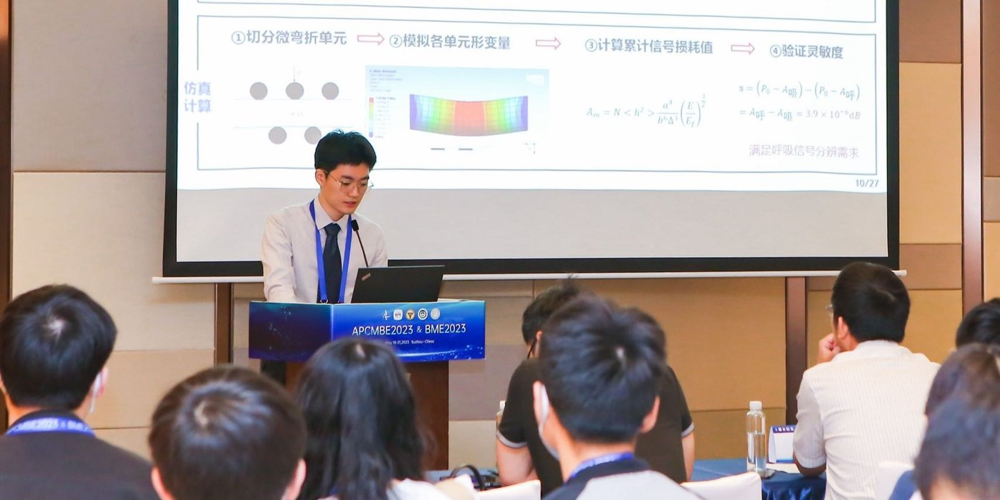
  <figcaption>Delivering an oral report at the Young Scholar Competition, Suzhou, 2023</figcaption>
</figure>

# 🔥 News
- *2026.01*: 🎉 Our paper "[*Robust non-rigid image-to-patient registration for contactless dynamic thoracic tumor localization using recursive deformable diffusion models*](https://doi.org/10.1016/j.media.2026.103948)" has been published in *Medical Image Analysis*!
- *2025.08*: 🎓 Started my Ph.D. in Prof. Siyi Xu's group at UIUC!
- *2025.06*: 🎉 Our paper "[*DRTT: A Diffusion-Based Framework for 4DCT Generation, Robust Thoracic Registration and Tumor Deformation Tracking*](https://doi.org/10.1109/IROS60139.2025.11247123)" has been accepted to *IROS 2025*!
- *2025.03*: 🎉🎉 Our paper "[*Full freedom-of-motion actuators as advanced haptic interfaces*](https://doi.org/10.1126/science.adt2481)" has been published in ***Science***!
- *2025.01*: 🏆 Awarded the Excellent Master's Dissertation of the School.
- *2024.12*: 🎓 Successfully defended my Master's dissertation, "*Full Freedom-of-Motion Haptic Actuator for Efficient Information Transfer in XR*". Many thanks to my advisor Prof. John A. Rogers, Prof. Edward Colgate, and Dr. Kyoungho Ha!
- *2024.10*: 🎉🎉 Our paper "[*Bioelastic state recovery for haptic sensory substitution*](https://doi.org/10.1038/s41586-024-08155-9)" has been accepted by ***Nature***!
- *2024.01*: 🎉 Our paper "[*A robotic system for transthoracic puncture of pulmonary nodules based on gated respiratory compensation*](https://doi.org/10.1016/j.cmpb.2023.107995)" has been accepted by *Computer Methods and Programs in Biomedicine*.
- *2023.05*: 🏆 Awarded 1st Prize for Outstanding Young Scholar Paper at BME 2023, Suzhou, China.
- *2023.01*: 🏆 Awarded the Agilent Scholarship for Excellence in Life Science. Grateful to Agilent for their support!
- *2022.06*: 🎓 Graduated from SJTU with the highest honors (*Best Thesis*, *Honours Degree*, and *Outstanding Graduate of Shanghai*)!

# 📖 Education

- *2025.08 – present*: **Ph.D.** in Mechanical Engineering, University of Illinois Urbana-Champaign
- *2022.09 – 2025.03*: **M.S.**, Northwestern University & Shanghai Jiao Tong University
- *2018.09 – 2022.06*: **B.S. (Hons.)** in Mechanical Engineering, Shanghai Jiao Tong University

# 🧑‍💻 Experience

- *2025.08 – present*: **Graduate Research Assistant**, Wearable and Implantable Soft Electronics & Robotics (WISER) Lab, UIUC, Urbana, IL
  - Advisor: Prof. [Siyi Xu](https://scholar.google.com/citations?user=XSY9SCIAAAAJ&hl=en)
  - Focus: soft sensors and actuators for wearable haptics and human–robot interaction

- *2023.09 – 2025.03*: **Research Assistant**, Querrey Simpson Institute for Bioelectronics, Northwestern University, Evanston, IL
  - Advisor: Prof. [John A. Rogers](https://scholar.google.com/citations?hl=en&user=VLxoLPsAAAAJ&view_op=list_works&sortby=pubdate)
<!--   - Mentors: Dr. Kyoungho Ha, Prof. [Matthew T. Flavin](https://flavinlab.io/people/), Dr. Wooyoul Maeng -->
  - Projects: bioelastic haptic actuator; multi-modal haptic actuator; soft robot for organoid interfaces

- *2021.09 – 2023.09*: **Research Assistant**, Institute of Biomedical Manufacturing and Life Quality Engineering, SJTU, Shanghai
  - Advisor: Prof. [Xiaojun Chen](https://scholar.google.com/citations?hl=en&user=NpzvK0kAAAAJ&view_op=list_works&sortby=pubdate)
  - Projects: robot-assisted thoracic puncture system; fiber-optic respiration sensor; temporal medical image generation

- *2022.01 – 2022.10*: **Embedded Development Intern**, [Espressif Systems](https://www.espressif.com/), Shanghai
  - Mentors: Zhaocheng Zhan, Li Zhou
  - Project: Mini Pupper (in collaboration with MangDang)

- *2021.06 – 2021.09*: **Research Assistant**, Institute of Medical Robotics, SJTU, Shanghai
  - Advisor: Prof. [Anzhu Gao](https://bme.sjtu.edu.cn/En/Show/3181)
  - Project: redundant robot design and manipulation

- *2020.02 – 2021.02*: **Research Assistant**, Institute of Robotics, SJTU, Shanghai
  - Advisor: Prof. [Jianjun Meng](https://scholar.google.com/citations?hl=en&user=Ahr8ZzsAAAAJ)
  - Project: motor imagery (MI)-based brain–computer interface (BCI)

# 📝 Publications

(\* Equal contribution)

## Journals

- **[J5]** [**Robust non-rigid image-to-patient registration for contactless dynamic thoracic tumor localization using recursive deformable diffusion models**](https://doi.org/10.1016/j.media.2026.103948) 
  D. Li, Y. Shan, <u>Y. Mao</u>, P. Tu, H. Shi, S. Huang, W. Sun, C. Chen, X. Chen. 
  <i>Medical Image Analysis</i>, 2026.

- **[J4]** [**Information Analysis System of Human Respiratory Motion for PET/CT Scanning**](https://doi.org/10.1007/s12204-025-2833-5) 
  <u>Y. Mao</u>\*, W. Liu, X. Chen. 
  <i>Journal of Shanghai Jiao Tong University (Science)</i>, 2025.

- **[J3]** [**Full Freedom-of-Motion Actuators as Advanced Haptic Interfaces**](https://doi.org/10.1126/science.adt2481) 
  K.-H. Ha\*, J. Yoo\*, S. Li\*, <u>Y. Mao</u>, S. Xu, H. Qi, H. Wu, C. Fan, H. Yuan, J.-T. Kim, M. Flavin, S. Yoo, P. Shahir, S. Kim, H.-Y. Ahn, E. Colgate, Y. Huang, J. A. Rogers. 
  <b><i>Science</i></b>, 2025.
  <figure class="figure">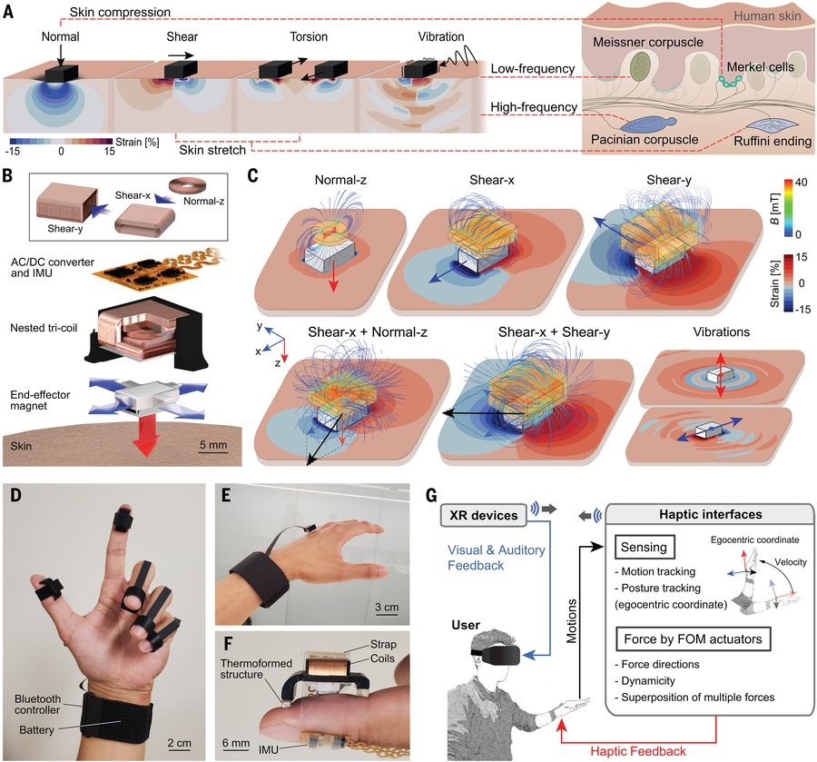</figure>

- **[J2]** [**Bioelastic State Recovery for Haptic Sensory Substitution**](https://doi.org/10.1038/s41586-024-08155-9) 
  M. Flavin\*, K.-H. Ha\*, Z. Guo\*, S. Li\*, J.-T. Kim\*, T. Saxena, D. Simatos, F. Al-Najjar, <u>Y. Mao</u>, S. Bandapalli, C. Fan, D. Bai, Z. Zhang, J. Yoo, M. Park, J. Shin, A. Huang, H. Shin, Y. Huang, Z. Xie, H. Jiang, J. A. Rogers. 
  <b><i>Nature</i></b>, 2024.
  <figure class="figure">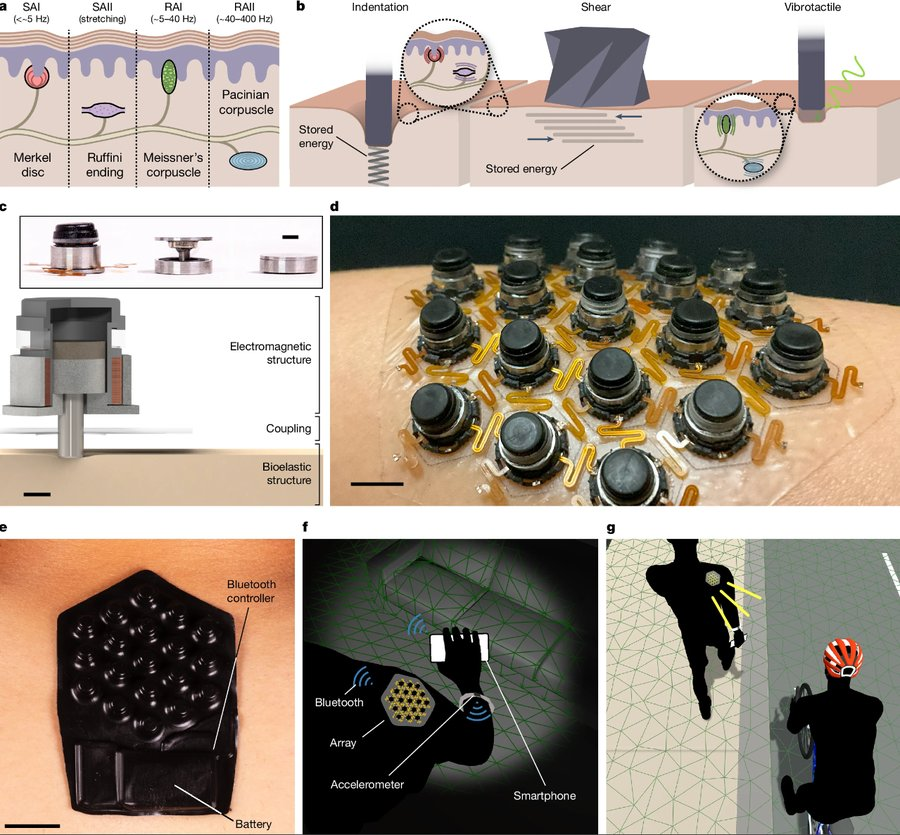</figure>

- **[J1]** [**A Robotic System for Transthoracic Puncture of Pulmonary Nodules Based on Gated Respiratory Compensation**](https://doi.org/10.1016/j.cmpb.2023.107995) 
  D. Li\*, <u>Y. Mao</u>\*, P. Tu, H. Shi, W. Sun, D. Zhao, C. Chen, X. Chen. 
  <i>Computer Methods and Programs in Biomedicine</i>, 2024.

## Conferences

- **[C2]** [**DRTT: A Diffusion-Based Framework for 4DCT Generation, Robust Thoracic Registration and Tumor Deformation Tracking**](https://doi.org/10.1109/IROS60139.2025.11247123) 
  D. Li, Y. Shan, <u>Y. Mao</u>, H. Shi, S. Huang, W. Sun, C. Chen, X. Chen. 
  <i>IEEE/RSJ International Conference on Intelligent Robots and Systems (IROS)</i>, 2025.

- **[C1]** [**A Cable-Driven Hyper-Redundant Robot with Angular Sensing**](https://doi.org/10.1109/ROBIO54168.2021.9739505) 
  <u>Y. Mao</u>, J. Yu, L. Wang, Y. Zou, Z. Lin, W. Chen, A. Gao. 
  <i>IEEE International Conference on Robotics and Biomimetics (ROBIO)</i>, 2021. <b>Oral</b>.
  <figure class="figure">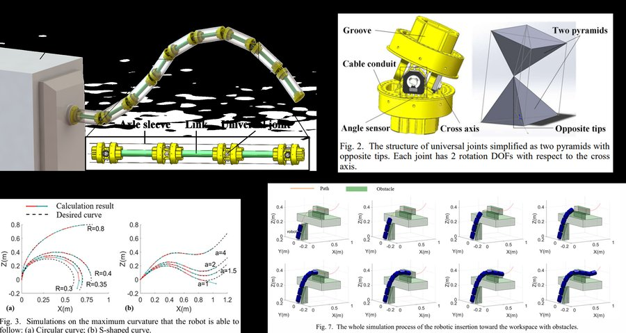</figure>

## In Preparation

- **[P1]** **Multimodal Microscaled Soft Robotic Actuator for Human Organoids Interfaces** 
  W. Maeng, Z. Lyu, K. Kim, K.-H. Ha, <u>Y. Mao</u>, S. Xu, L. Praba, Y. Hwang, J. A. Rogers.

# 🛠️ Projects

Beyond research, I enjoy designing robots and AI systems inspired by nature and daily life, turning textbook concepts into working technology.

## Robots and Mechanisms

<video src='/images/web/rrr-bot.mp4' width="80%" autoplay loop muted playsinline preload="metadata"></video>

**Wrist Rehabilitation Assistive Device Based on a 3-RRR Mechanism**

<u>Y. Mao</u>, P. Lin, R. Liu, B. Liang, A. Sun, Y. Jin

- A 3-RRR spherical parallel mechanism provides independent rotation in three degrees of freedom (DoF), covering the full range of wrist motion.
- Force sensors and an IMU enable accurate trajectory reproduction with controlled resistance, letting patients with wrist injuries train muscles across 3 DoF with adaptive damping.
- **Excellence in Technology Award**, 2023 Mechatronics Fair, School of Mechanical Engineering, SJTU.

<video src='/images/web/mini-pupper.mp4' width="80%" autoplay loop muted playsinline preload="metadata"></video>

**Mini Pupper: A Lightweight, Modular 12-DoF Quadruped Robot Based on ESP32**

[Project](https://www.kickstarter.com/projects/mdrobotkits/mini-pupper-2-open-source-ros2-robot-kit-for-dreamers) \| [Video](https://youtu.be/KGVOi1Mrjb0?t=138)

MangDang Tech, <u>Y. Mao</u>, Z. Zhang

- Developed a lightweight, modular 12-DoF quadruped robot across the full hardware/software stack.
- Verified ESP32 compatibility with micro-ROS, extending the platform's applicability to robotics.

Patent Granted
<video src='/images/web/jumpiter.mp4' width="80%" autoplay loop muted playsinline preload="metadata"></video>

**Jumpiter: A Cam-Powered Dual-Mode Mobile-Jumping Robot**

X. Xu, <u>Y. Mao</u>, H. Bai, Z. Mei, M. Xia

- Supports both wheeled locomotion and periodic jumps of up to 400 mm, storing and releasing energy through a cam–spring mechanism.
- Maintains in-air orientation using an IMU and a flywheel for mid-air attitude adjustment.
- Granted utility model patent (CN215904637U).

1st Prize
<video src='/images/web/stair-climber.mp4' width="80%" autoplay loop muted playsinline preload="metadata"></video>

**A Curvature-Adaptive Roller Clamping Mechanism for Heavy-Load Transportation on Staircases**

H. Yan, <u>Y. Mao</u>, H. Mao, Z. Zhang

- An adaptive roller system conforms to various staircase shapes and smoothly navigates corners.
- An integrated loading lever enables manual transport of heavy loads with significantly reduced effort.
- **1st Prize**, Shanghai Mechanical Engineering Innovation Competition; **2nd Prize**, National Mechanical Engineering Innovation Competition.

## Artificial Intelligence

<video src='/images/web/swarm.mp4' width="80%" autoplay loop muted playsinline preload="metadata"></video>

**Dynamic Multi-Robot Swarm Formation Based on Distributed Control**

<u>Y. Mao</u>, J. Yu, Z. Wang, F. Du

- Programmed a 5-robot swarm in ROS using consensus algorithms for distributed control, enabling dynamic formation changes based on obstacle detection.

<video src='/images/web/robocup-marl.mp4' width="80%" autoplay loop muted playsinline preload="metadata"></video>

**Cooperation and Confrontation in Multi-Agent Reinforcement Learning for RoboCup**

<u>Y. Mao</u>, J. Liang, Z. Li, S. Chen

- Trained a 2v2 soccer simulation in Unity 3D with the Multi-Agent POsthumous Credit Assignment (MA-POCA) algorithm; agents learned coordinated offense and defense.

<video src='/images/web/chord-fft.mp4' width="80%" autoplay loop muted playsinline preload="metadata"></video>

**Real-Time Guitar Chord Decomposition Using FFT**

<u>Y. Mao</u>

- Built a LabVIEW program for real-time frequency-domain analysis of captured audio, decomposing guitar chords with 90% accuracy.

<!--
# Awards
2023 1st Prize, Young Excellent Paper Competition, BME2023 (China)
2022 Agilent Scholarship (5/773)
2022 Excellent Bachelor Thesis of SJTU (Top 1%)
2022 Outstanding Graduate of Shanghai (Top 2%)
2019-2021 Zhiyuan Honors Scholarship (Top 5%)
2021 Guanghua Scholarship
2021 TYACHT Outstanding Student (5/424)
2021 Zhiyuan Outstanding Leader Scholarship
2021 COSCO-shipping Scholarship
2020 1st Prize, Shanghai Mechanical Engineering Innovation Competition
2020 2nd Prize, National Mechanical Design Competition
2019 Shanghai Scholarship (1/206)
--!>

<!--
# 🔧 Skills
As a researcher and engineer, I have developed comprehensive **full-stack** skills in bio-mechatronics, which I have further refined through hands-on experience in various projects.

- **Mechanical**:
    - CAD (Solidworks, AutoCAD, FreeCAD, iSight), Simulation (Abaqus, Adams)
    - Rapid Prototyping (3D Printing (FDM and SLA), Laser Cutting), CNC machining
    - Motor control (DC, Step, Servo), Valve control (Solenoid, Proportional)
- **Electrical**:
    - (Micro)Soldering, wiring
    - Embedded System Development (Arduino, STM32, ESP32)
    - Signal Processing
- **Programming**:
    - MATLAB/Simulink, LabVIEW
    - C/C++, Python, Swift
- **Robotics**:
    - ROS/ROS2/MicroROS, V-REP/CoppeliaSim, Gazebo
    - Protocols (UART, I2C, SPI, CAN)
- **Equipments**:
    - Tensile/Compression Tester, Dynamic Fatigue Tester
    - Vital Signs Monitor (SPO2, HR, Resp), EEG Cap
    - *NDI* Optical/Electromagnetic Tracker
- **Others**:
    - Micro-Fabrication, Thin-film Coating Processes
    - Digital Image Correlation (DIC)
    - Statistical/Machine Learning
    - ...
-->
<!--
# 📷 Album
While working diligently and efficiently, I also make it a priority to nurture both my body and mind.

 

    

<i>With Master's Defense Committee, Evanston, IL, 2024</i>

 

 

    

<i>With Jinda at SJTU Anual Running Festival, Shanghai, 2021</i>

 
-->

<!--
 

    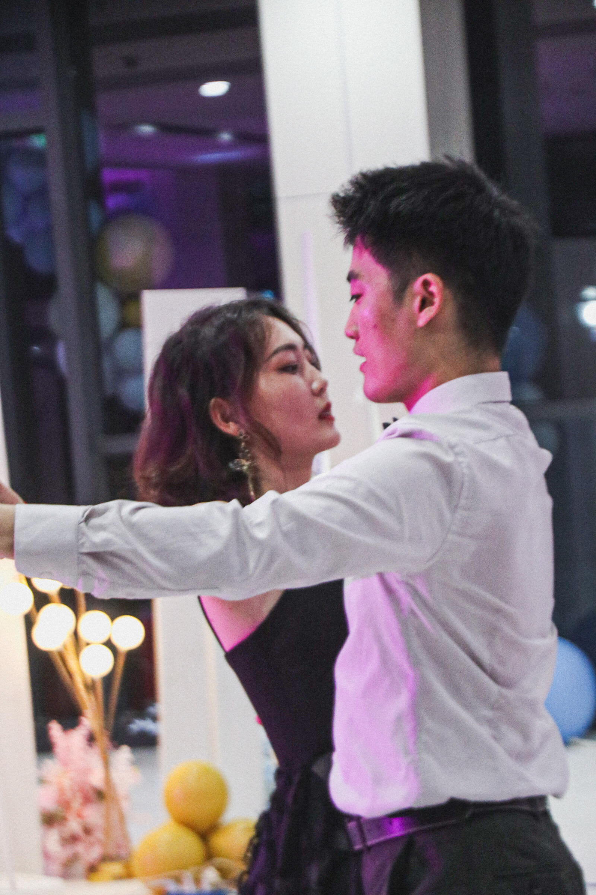

<i>Dancing with Qianru at the graduation prom, shanghai, 2023</i>

 
-->

<!--

    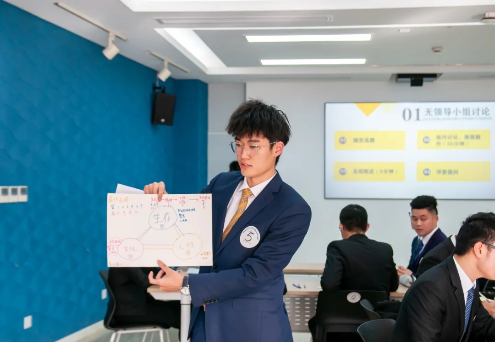

<i>Presenting in TYACHT outstanding student selection, Shanghai, 2021</i>

 

    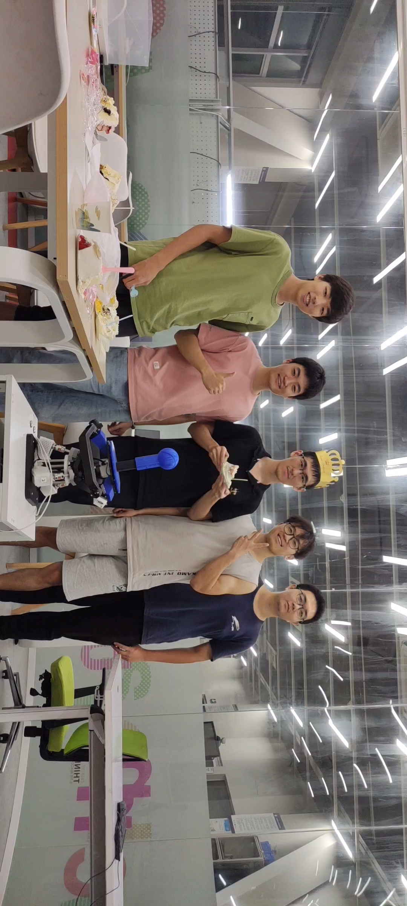

<i>With team of RRR-Robot at dawn before the final report, Shanghai, 2023</i>

 

    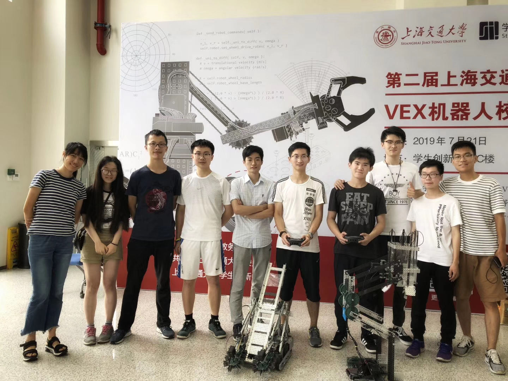

<i>With Team members after winning VEX Competition, Shanghai, 2019</i> 

-->

<!--

    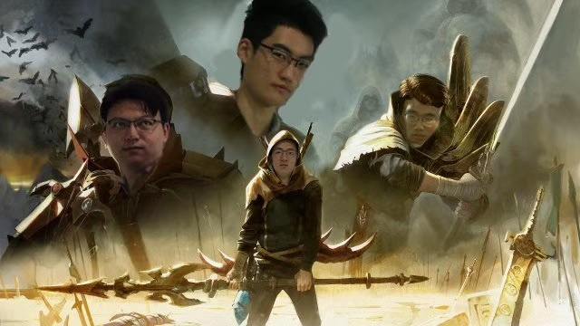

<i>Cosplay with classmates of LOL MV Rise, Shanghai, 2019</i>

-->

<!--

    

<i>After winning ME design competition, Shanghai, 2020</i>

-->

<!--

    

<i>with friends at Salty Lake City</i>

-->

<!--

    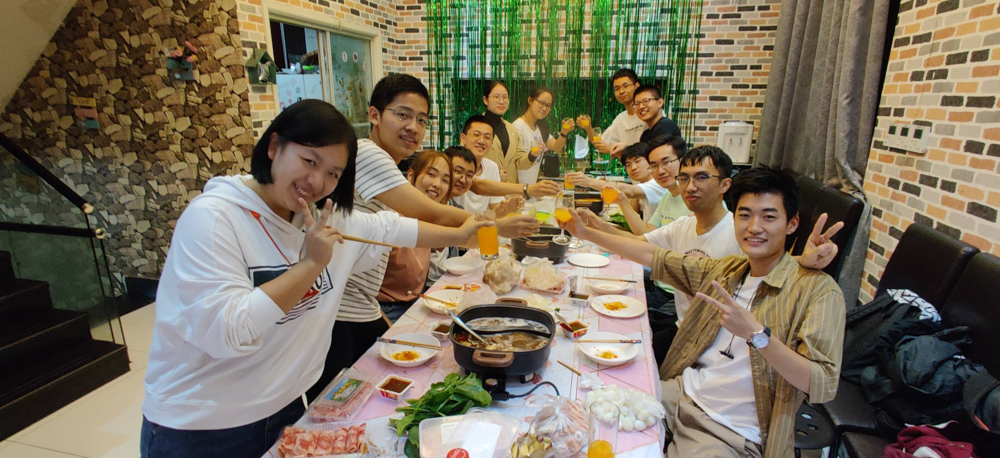

<i>With colleagues of student union, Shanghai, 2020</i>

    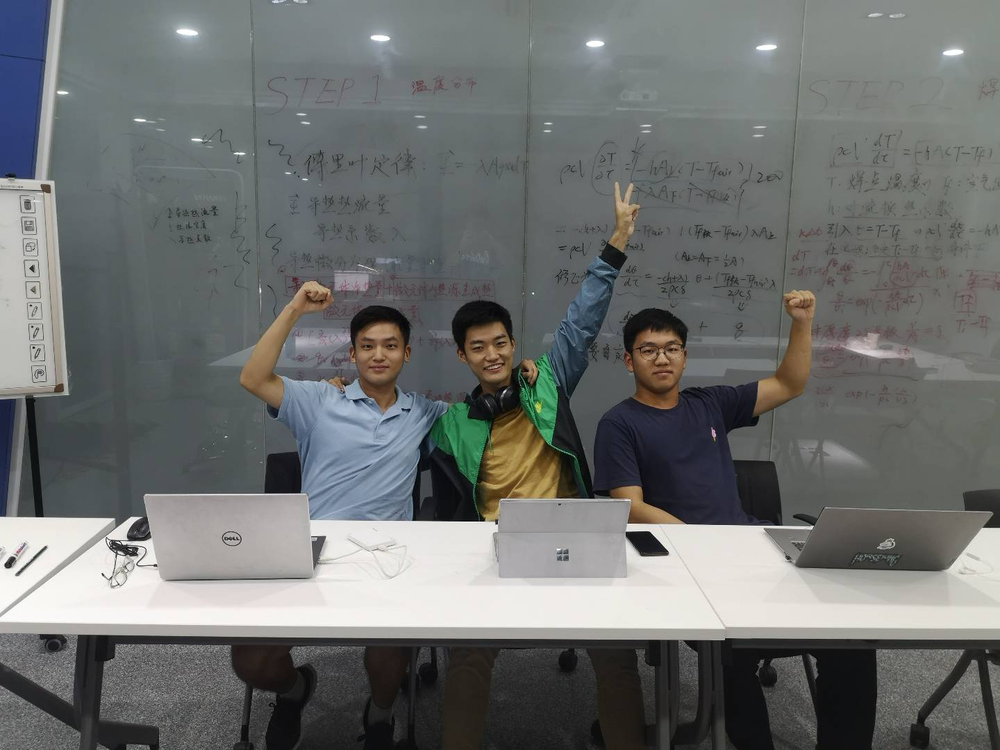

<i>With Beichen and Ziyu after submitting paper to MEM, Shanghai, 2020</i>

    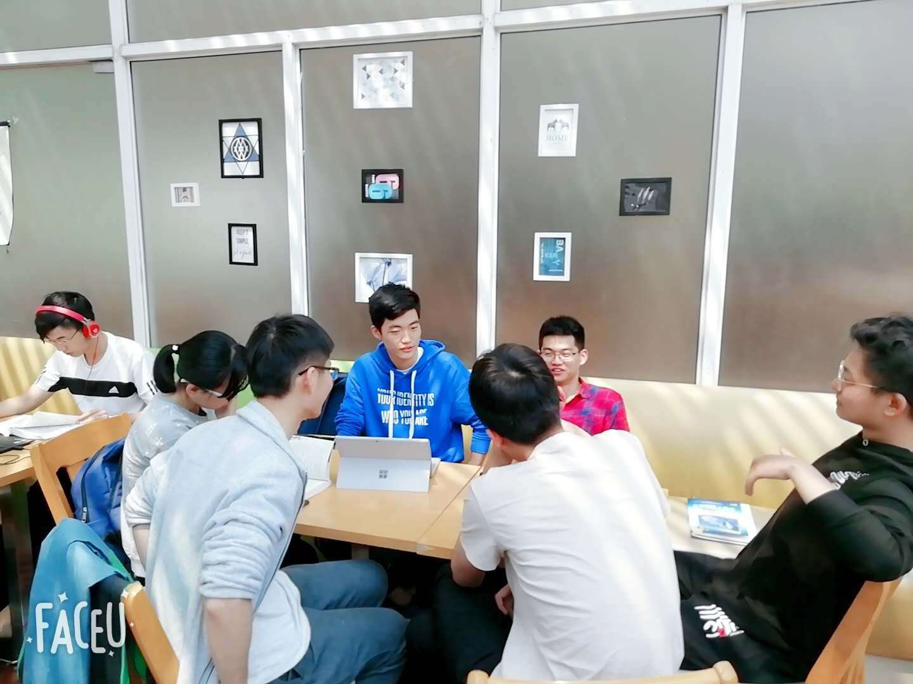

<i>holding a reading salon in the honors class, Shanghai, 2019

-->
