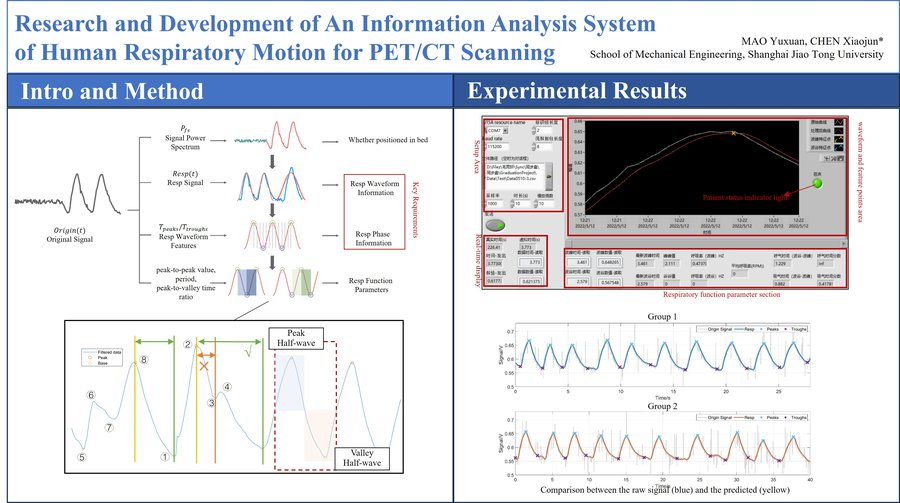
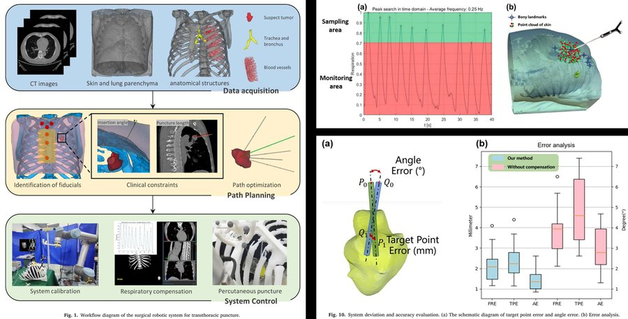








<!--
Hi! I'm Yuxuan, an M.S. student in Mechanical Engineering at **Northwestern University**. Before this, I worked as an embedded development engineer at Espressif, known for its ESP32 platform. I earned my B.S. (Hons.) in Mechanical Engineering from **Shanghai Jiao Tong University** in 2022.

 
My research interests include **actuator mechanisms**, **wearable robotics**, and **stretchable electronics**. Currently, I’m conducting research at the Simpson Querrey Institute for Bioelectronics under the supervision of Prof. John A. Rogers, focusing on multi-modal actuators and soft robotics, particularly in the areas of haptics and organoid interfaces. My expertise spans a wide range of bio-mechatronics skills, such as rapid prototyping, micro-fabrication, embedded programming and machine learning.

 
As an INTJ (Introverted-Intuitive-Thinking-Judging), I bring **resilience**, **critical thinking**, and a genuine **passion for technology** to my work. Outside of academics, I enjoy playing and singing RNB on the ukulele, playing basketball, and exploring science fiction and epic stories.
Hi! I'm Yuxuan, an M.S. student in Mechanical Engineering at Northwestern University with a GPA of 3.86/4.0. I earned my B.S. (Hons.) in Mechanical Engineering from Shanghai Jiao Tong University in 2022, graduating with all highest honors for undergraduates, including Best Thesis, Honors Degree, and Outstanding Graduate of Shanghai.

My research interests lie in actuator mechanisms, wearable robotics, and stretchable electronics. Currently, I am conducting research at the Simpson Querrey Institute for Bioelectronics under the guidance of Prof. John A. Rogers, focusing on multi-modal actuators and soft robotics, particularly in the fields of haptics and organoid studies. I have 5 years experiences in reseach, including working as RA in National Key lab of Mechanical Systems and Vibiration (MSV), Institude of Medical Robots (IMR) in SJTU. To date, I have contributed to seven papers as a lead or core author, published in journals including Nature and Science.

Beyond research, I am passionate about transforming concepts from textbooks into real-world technologies inspired by nature and everyday life. My extensive hands-on projects in novel robots and AI models have helped me develop into a full-stack engineer, with skills spanning a wide range of bio-mechatronics domains such as rapid prototyping, microfabrication, embedded programming, and machine learning.
-->

I'm a Ph.D. student in Mechanical Engineering at the <b>University of Illinois Urbana-Champaign</b>, advised by Prof. <a href="https://scholar.google.com/citations?user=XSY9SCIAAAAJ&hl=en">Siyi Xu</a> in the <a href="https://publish.illinois.edu/wiserlaboratory/">WISER Lab</a>. I build <b>soft, stretchable sensors and actuators</b> for <b>wearable haptics</b> and <b>human–robot interaction</b>.

Before UIUC, I worked with Prof. <a href="https://scholar.google.com/citations?hl=en&user=VLxoLPsAAAAJ&view_op=list_works&sortby=pubdate">John A. Rogers</a> at <b>Northwestern University</b> and Prof. <a href="https://scholar.google.com/citations?hl=en&user=NpzvK0kAAAAJ&view_op=list_works&sortby=pubdate">Xiaojun Chen</a> at <b>Shanghai Jiao Tong University</b>, where I received my M.S. and B.S. (Hons.).

<b>Research interests:</b> Wearable Haptics · Soft Sensors &amp; Actuators · Human–Robot Interaction · Surgical Robotics 
<b>Highlights:</b> 7 papers as lead/core author, including <b><i>Nature</i></b> and <b><i>Science</i></b>

  
  
Oral report at the Young Scholar Competition, Suzhou, 2023

# 🔥 News

<ul class="news">
  <li>2026.09📜 Invention patent granted for our 3-RRR wrist rehabilitation robot (CN117283527B).</li>
  <li>2026.01🎉 Tumor-localization paper published in <a href="https://doi.org/10.1016/j.media.2026.103948"><i>Medical Image Analysis</i></a>.</li>
  <li>2025.08🎓 Started my Ph.D. at UIUC.</li>
  <li>2025.06🎉 <a href="https://doi.org/10.1109/IROS60139.2025.11247123">DRTT</a> accepted to <i>IROS 2025</i>.</li>
  <li>2025.03🎉 Full freedom-of-motion haptic actuators published in <a href="https://doi.org/10.1126/science.adt2481"><b><i>Science</i></b></a>.</li>
  <li>2024.10🎉 Bioelastic haptic sensory substitution accepted by <a href="https://doi.org/10.1038/s41586-024-08155-9"><b><i>Nature</i></b></a>.</li>
</ul>

More news

<ul class="news">
  <li>2025.01🏆 Excellent Master's Dissertation award.</li>
  <li>2024.12🎓 Defended my M.S. thesis on full freedom-of-motion haptic actuators for XR.</li>
  <li>2024.01🎉 Robotic thoracic puncture system accepted by <a href="https://doi.org/10.1016/j.cmpb.2023.107995"><i>CMPB</i></a>.</li>
  <li>2023.05🏆 1st Prize, Outstanding Young Scholar Paper, BME 2023.</li>
  <li>2023.01🏆 Agilent Scholarship for Excellence in Life Science.</li>
  <li>2022.06🎓 Graduated from SJTU with highest honors (Best Thesis, Outstanding Graduate of Shanghai).</li>
</ul>

# 📖 Education

<ul class="timeline">
  <li><b>Ph.D.</b>, Mechanical Engineering, University of Illinois Urbana-Champaign2025 – present</li>
  <li><b>M.S.</b>, Northwestern University &amp; Shanghai Jiao Tong University2022 – 2025</li>
  <li><b>B.S. (Hons.)</b>, Mechanical Engineering, Shanghai Jiao Tong University2018 – 2022</li>
</ul>

# 🧑‍💻 Experience

<ul class="timeline">
  <li><b>Graduate Research Assistant</b>, WISER Lab, UIUCAdvisor: Prof. <a href="https://scholar.google.com/citations?user=XSY9SCIAAAAJ&hl=en">Siyi Xu</a>2025.08 – present</li>
  <li><b>Research Assistant</b>, Querrey Simpson Institute for Bioelectronics, NorthwesternAdvisor: Prof. <a href="https://scholar.google.com/citations?hl=en&user=VLxoLPsAAAAJ&view_op=list_works&sortby=pubdate">John A. Rogers</a> · Haptic actuators, soft organoid interfaces2023.09 – 2025.03</li>
<!--   - Mentors: Dr. Kyoungho Ha, Prof. [Matthew T. Flavin](https://flavinlab.io/people/), Dr. Wooyoul Maeng -->
  <li><b>Research Assistant</b>, Institute of Biomedical Manufacturing &amp; Life Quality Engineering, SJTUAdvisor: Prof. <a href="https://scholar.google.com/citations?hl=en&user=NpzvK0kAAAAJ&view_op=list_works&sortby=pubdate">Xiaojun Chen</a> · Surgical robotics, respiration sensing, medical imaging2021.09 – 2023.09</li>
  <li><b>Embedded Development Intern</b>, <a href="https://www.espressif.com/">Espressif Systems</a>Mini Pupper, in collaboration with MangDang2022.01 – 2022.10</li>
  <li><b>Research Assistant</b>, Institute of Medical Robotics, SJTUAdvisor: Prof. <a href="https://bme.sjtu.edu.cn/En/Show/3181">Anzhu Gao</a> · Redundant robot design2021.06 – 2021.09</li>
  <li><b>Research Assistant</b>, Institute of Robotics, SJTUAdvisor: Prof. <a href="https://scholar.google.com/citations?hl=en&user=Ahr8ZzsAAAAJ">Jianjun Meng</a> · Motor-imagery BCI2020.02 – 2021.02</li>
</ul>

# 📝 Publications

* Equal contribution

  
Science 2025

  

    <a class="title" href="https://doi.org/10.1126/science.adt2481">Full Freedom-of-Motion Actuators as Advanced Haptic Interfaces</a>
    K.-H. Ha*, J. Yoo*, S. Li*, <u>Y. Mao</u>, S. Xu, H. Qi, H. Wu, C. Fan, H. Yuan, J.-T. Kim, M. Flavin, S. Yoo, P. Shahir, S. Kim, H.-Y. Ahn, E. Colgate, Y. Huang, J. A. Rogers
    <b>Science</b>, 2025
  

  
Nature 2024

  

    <a class="title" href="https://doi.org/10.1038/s41586-024-08155-9">Bioelastic State Recovery for Haptic Sensory Substitution</a>
    M. Flavin*, K.-H. Ha*, Z. Guo*, S. Li*, J.-T. Kim*, T. Saxena, D. Simatos, F. Al-Najjar, <u>Y. Mao</u>, S. Bandapalli, C. Fan, D. Bai, Z. Zhang, J. Yoo, M. Park, J. Shin, A. Huang, H. Shin, Y. Huang, Z. Xie, H. Jiang, J. A. Rogers
    <b>Nature</b>, 2024
  

  
MedIA 2026
Medical Image Analysis

  

    <a class="title" href="https://doi.org/10.1016/j.media.2026.103948">Robust Non-Rigid Image-to-Patient Registration for Contactless Dynamic Thoracic Tumor Localization Using Recursive Deformable Diffusion Models</a>
    D. Li, Y. Shan, <u>Y. Mao</u>, P. Tu, H. Shi, S. Huang, W. Sun, C. Chen, X. Chen
    Medical Image Analysis, 2026
  

  
IROS 2025
IEEE/RSJ IROS

  

    <a class="title" href="https://doi.org/10.1109/IROS60139.2025.11247123">DRTT: A Diffusion-Based Framework for 4DCT Generation, Robust Thoracic Registration and Tumor Deformation Tracking</a>
    D. Li, Y. Shan, <u>Y. Mao</u>, H. Shi, S. Huang, W. Sun, C. Chen, X. Chen
    IEEE/RSJ International Conference on Intelligent Robots and Systems (IROS), 2025
  

  
JSJTU 2025

  

    <a class="title" href="https://doi.org/10.1007/s12204-025-2833-5">Information Analysis System of Human Respiratory Motion for PET/CT Scanning</a>
    <u>Y. Mao</u>*, W. Liu, X. Chen
    Journal of Shanghai Jiao Tong University (Science), 2025
  

  
CMPB 2024

  

    <a class="title" href="https://doi.org/10.1016/j.cmpb.2023.107995">A Robotic System for Transthoracic Puncture of Pulmonary Nodules Based on Gated Respiratory Compensation</a>
    D. Li*, <u>Y. Mao</u>*, P. Tu, H. Shi, W. Sun, D. Zhao, C. Chen, X. Chen
    Computer Methods and Programs in Biomedicine, 2024
  

  
ROBIO 2021 · Oral

  

    <a class="title" href="https://doi.org/10.1109/ROBIO54168.2021.9739505">A Cable-Driven Hyper-Redundant Robot with Angular Sensing</a>
    <u>Y. Mao</u>, J. Yu, L. Wang, Y. Zou, Z. Lin, W. Chen, A. Gao
    IEEE International Conference on Robotics and Biomimetics (ROBIO), 2021
  

## In Preparation

<ul class="timeline">
  <li><b>Multimodal Microscaled Soft Robotic Actuator for Human Organoids Interfaces</b>W. Maeng, Z. Lyu, K. Kim, K.-H. Ha, <u>Y. Mao</u>, S. Xu, L. Praba, Y. Hwang, J. A. Rogers</li>
</ul>

# 🛠️ Projects

## Robots and Mechanisms

  
Patent Granted<video src="/images/web/rrr-bot.mp4" autoplay loop muted playsinline preload="metadata"></video>

  

    Wrist Rehabilitation Assistive Device Based on a 3-RRR Mechanism
    <u>Y. Mao</u>, P. Lin, R. Liu, B. Liang, A. Sun, Y. Jin
    
A 3-DoF parallel robot covering the full range of wrist motion, using force and IMU sensing for adaptive-resistance training.

    
🏆 Excellence in Technology Award, 2023 · Invention patent CN117283527B

  

  
<video src="/images/web/mini-pupper.mp4" autoplay loop muted playsinline preload="metadata"></video>

  

    Mini Pupper: A Lightweight, Modular 12-DoF Quadruped Robot Based on ESP32
    MangDang Tech, <u>Y. Mao</u>, Z. Zhang
    <a href="https://www.kickstarter.com/projects/mdrobotkits/mini-pupper-2-open-source-ros2-robot-kit-for-dreamers">Project</a> · <a href="https://youtu.be/KGVOi1Mrjb0?t=138">Video</a>
    
A lightweight, modular quadruped developed across the full stack; validated micro-ROS on ESP32.

  

  
Patent Granted<video src="/images/web/jumpiter.mp4" autoplay loop muted playsinline preload="metadata"></video>

  

    Jumpiter: A Cam-Powered Dual-Mode Mobile-Jumping Robot
    X. Xu, <u>Y. Mao</u>, H. Bai, Z. Mei, M. Xia
    
Drives and jumps up to 400 mm using a cam–spring energy mechanism, with IMU + flywheel attitude control in the air.

    
Utility model patent CN215904637U

  

  
1st Prize<video src="/images/web/stair-climber.mp4" autoplay loop muted playsinline preload="metadata"></video>

  

    A Curvature-Adaptive Roller Clamping Mechanism for Heavy-Load Transportation on Staircases
    H. Yan, <u>Y. Mao</u>, H. Mao, Z. Zhang
    
Rollers conform to different staircases and corners; a loading lever greatly reduces the effort of manual transport.

    
🏆 1st Prize, Shanghai ME Innovation Competition · 2nd Prize, National

  

## Artificial Intelligence

  
<video src="/images/web/swarm.mp4" autoplay loop muted playsinline preload="metadata"></video>

  

    Dynamic Multi-Robot Swarm Formation Based on Distributed Control
    <u>Y. Mao</u>, J. Yu, Z. Wang, F. Du
    
A 5-robot ROS swarm using consensus algorithms to reshape its formation around obstacles.

  

  
<video src="/images/web/robocup-marl.mp4" autoplay loop muted playsinline preload="metadata"></video>

  

    Cooperation and Confrontation in Multi-Agent Reinforcement Learning for RoboCup
    <u>Y. Mao</u>, J. Liang, Z. Li, S. Chen
    
2v2 soccer agents trained with MA-POCA in Unity, learning coordinated offense and defense.

  

  
<video src="/images/web/chord-fft.mp4" autoplay loop muted playsinline preload="metadata"></video>

  

    Real-Time Chord Decomposition for Guitar Playing Using FFT
    <u>Y. Mao</u>
    
A LabVIEW tool that decomposes guitar chords in real time with 90% accuracy.

  

<!--
# Awards
2023 1st Prize, Young Excellent Paper Competition, BME2023 (China)
2022 Agilent Scholarship (5/773)
2022 Excellent Bachelor Thesis of SJTU (Top 1%)
2022 Outstanding Graduate of Shanghai (Top 2%)
2019-2021 Zhiyuan Honors Scholarship (Top 5%)
2021 Guanghua Scholarship
2021 TYACHT Outstanding Student (5/424)
2021 Zhiyuan Outstanding Leader Scholarship
2021 COSCO-shipping Scholarship
2020 1st Prize, Shanghai Mechanical Engineering Innovation Competition
2020 2nd Prize, National Mechanical Design Competition
2019 Shanghai Scholarship (1/206)
--!>

<!--
# 🔧 Skills
As a researcher and engineer, I have developed comprehensive **full-stack** skills in bio-mechatronics, which I have further refined through hands-on experience in various projects.

- **Mechanical**:
    - CAD (Solidworks, AutoCAD, FreeCAD, iSight), Simulation (Abaqus, Adams)
    - Rapid Prototyping (3D Printing (FDM and SLA), Laser Cutting), CNC machining
    - Motor control (DC, Step, Servo), Valve control (Solenoid, Proportional)
- **Electrical**:
    - (Micro)Soldering, wiring
    - Embedded System Development (Arduino, STM32, ESP32)
    - Signal Processing
- **Programming**:
    - MATLAB/Simulink, LabVIEW
    - C/C++, Python, Swift
- **Robotics**:
    - ROS/ROS2/MicroROS, V-REP/CoppeliaSim, Gazebo
    - Protocols (UART, I2C, SPI, CAN)
- **Equipments**:
    - Tensile/Compression Tester, Dynamic Fatigue Tester
    - Vital Signs Monitor (SPO2, HR, Resp), EEG Cap
    - *NDI* Optical/Electromagnetic Tracker
- **Others**:
    - Micro-Fabrication, Thin-film Coating Processes
    - Digital Image Correlation (DIC)
    - Statistical/Machine Learning
    - ...
-->
<!--
# 📷 Album
While working diligently and efficiently, I also make it a priority to nurture both my body and mind.

 

    

<i>With Master's Defense Committee, Evanston, IL, 2024</i>

 

 

    

<i>With Jinda at SJTU Anual Running Festival, Shanghai, 2021</i>

 
-->

<!--
 

    

<i>Dancing with Qianru at the graduation prom, shanghai, 2023</i>

 
-->

<!--

    

<i>Presenting in TYACHT outstanding student selection, Shanghai, 2021</i>

 

    

<i>With team of RRR-Robot at dawn before the final report, Shanghai, 2023</i>

 

    

<i>With Team members after winning VEX Competition, Shanghai, 2019</i> 

-->

<!--

    

<i>Cosplay with classmates of LOL MV Rise, Shanghai, 2019</i>

-->

<!--

    

<i>After winning ME design competition, Shanghai, 2020</i>

-->

<!--

    

<i>with friends at Salty Lake City</i>

-->

<!--

    

<i>With colleagues of student union, Shanghai, 2020</i>

    

<i>With Beichen and Ziyu after submitting paper to MEM, Shanghai, 2020</i>

    

<i>holding a reading salon in the honors class, Shanghai, 2019

-->
